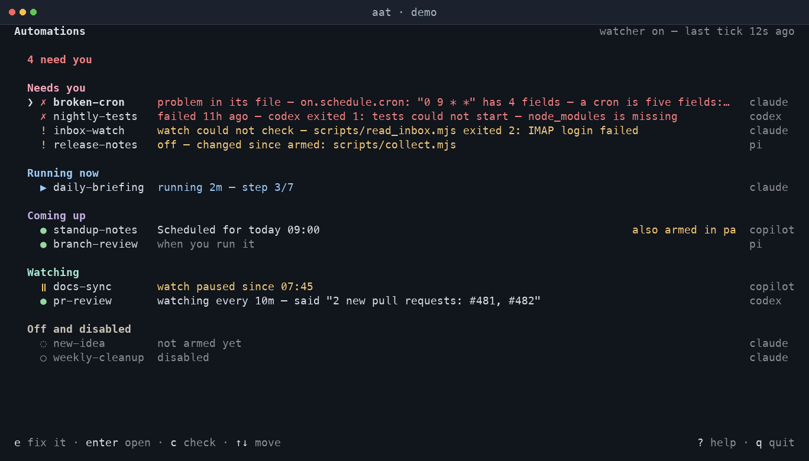
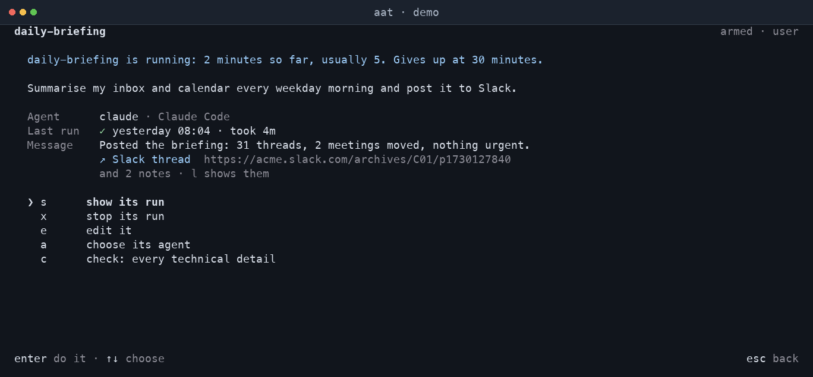
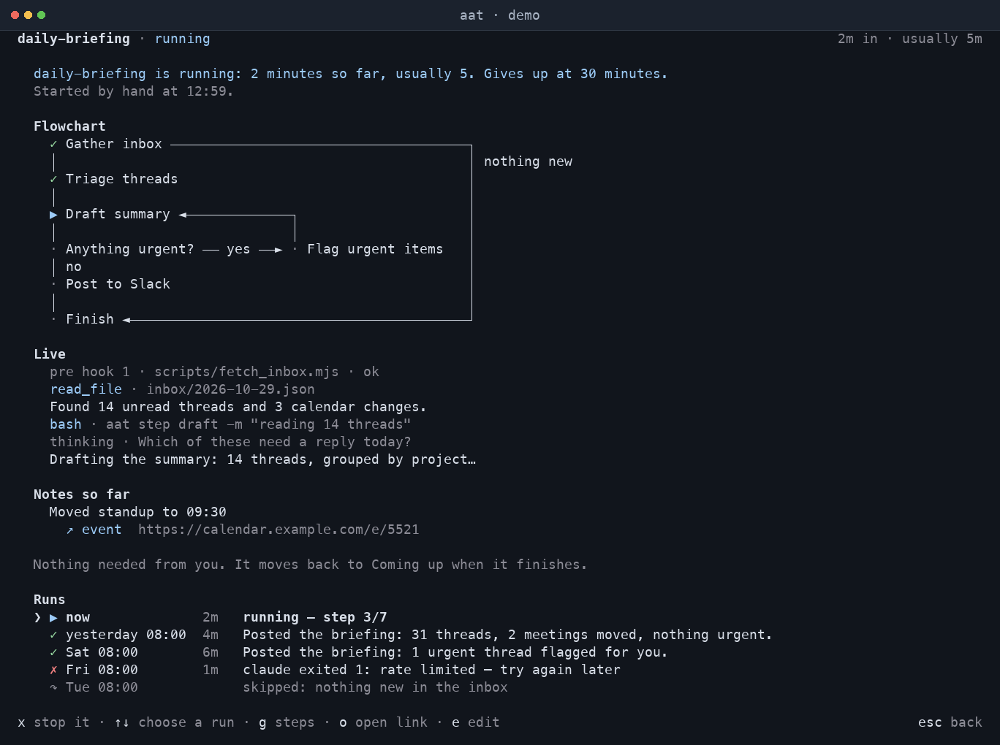

# Agent Automations

The Agent Automations Draft 0.1.0 specification describes a portable format for
running AI agents on a schedule, when a watch script finds work, or on demand.
Read the specification and guides at <https://lucas-stanford.github.io/agent-automations/>.
The host-neutral agent skill is in [skills/agent-automations](skills/agent-automations/SKILL.md).

## Terminal host

The [aat](aat/README.md) Rust application runs automations through an agent CLI.
To try its terminal UI with demo data, without starting a watcher:

```sh
cargo run --locked -p aat -- tui --fake
```

## Screenshots

These screens use demo data; no real automation or watcher is started.

### Automation overview



### Automation details



### Run progress



## Build and check

With Rust 1.85 or newer:

```sh
cargo test --locked --workspace
```

With Node.js 22.19 or newer:

```sh
npm ci
npm run build
npm test
```

Edit the Markdown in `site/content/` and run the build to regenerate `docs/`.
Open `docs/index.html` directly to browse the site. The tests check links,
examples against a pinned reference parser, and the committed build output.

## License

[MIT](LICENSE)
